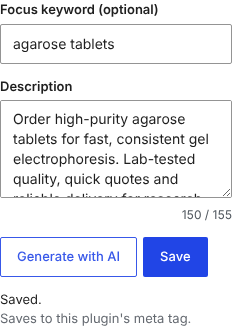
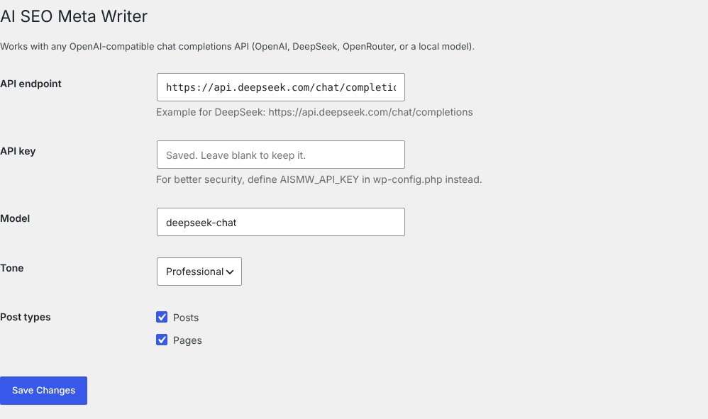

# AI SEO Meta Writer

A WordPress plugin that writes SEO meta descriptions for posts, pages and WooCommerce products with an AI model, then saves them where your SEO plugin reads them: **Yoast SEO**, **Rank Math**, or the plugin's own `<meta name="description">` tag.

It works with any OpenAI-compatible chat completions API: OpenAI, DeepSeek, OpenRouter or a local model.

| Editor meta box | Settings |
|---|---|
|  |  |

## Features

- **One-click generation** in the editor's sidebar, with an optional focus keyword and a live character counter (155 max).
- **Edit before saving.** The suggestion is only saved when you click Save.
- **Works with your SEO plugin.** It detects Yoast SEO or Rank Math and writes to their meta fields, so the description shows in their own UI. Without one, it prints its own meta tag.
- **WooCommerce aware.** For products, it uses the short description first.
- **Bulk generation with WP-CLI** for items that don't have a description yet:
  ```sh
  wp ai-meta generate --post_type=product --limit=50
  wp ai-meta generate --post_type=post --dry-run
  ```
- **Clean output.** It strips quotes, labels and HTML, and cuts long answers at a word boundary instead of mid-word.

## Security

- AJAX requests are protected with nonces and check `edit_post` for the specific post.
- All input is sanitised and all output escaped.
- The API key is never printed back into the settings form. You can also keep it out of the database by setting it in `wp-config.php`:
  ```php
  define( 'AISMW_API_KEY', 'your-key' );
  ```
- Uninstalling removes the plugin's options and its own meta. Descriptions saved into Yoast SEO or Rank Math are kept.

## Installation

1. Copy the `ai-seo-meta-writer` folder to `wp-content/plugins/` and activate it.
2. Go to **Settings → AI SEO Meta Writer**. Set the endpoint, API key and model, and choose the post types.
   - OpenAI: `https://api.openai.com/v1/chat/completions`, model `gpt-4o-mini`
   - DeepSeek: `https://api.deepseek.com/chat/completions`, model `deepseek-chat`
3. Open any post or product and use the **AI meta description** box.

## Structure

```
ai-seo-meta-writer.php           Bootstrap and wiring
includes/
  class-aismw-generator.php      Prompt building and output cleaning (pure PHP, unit tested)
  class-aismw-client.php         HTTP client for the chat completions API
  class-aismw-seo-bridge.php     Yoast SEO / Rank Math / own meta tag
  class-aismw-meta-box.php       Editor meta box and AJAX handlers
  class-aismw-settings.php       Settings page (Settings API)
  class-aismw-cli.php            WP-CLI bulk command
assets/                          Admin JS and CSS (no jQuery)
tests/                           PHPUnit tests
```

## Development

```sh
composer install
vendor/bin/phpunit
```

GitHub Actions lints the code and runs the tests on PHP 7.4, 8.1 and 8.3.

## Hooks

- `aismw_generated_description` (filter): change the text before it is shown, for example to add a brand suffix.

## About

Built by [Abdul Hakeem](https://www.linkedin.com/in/abdul-hakeem-a0b075254/), a senior WordPress and PHP developer. It was built with AI-assisted development and tested on WordPress 7.2 with an OpenAI-compatible API.

License: GPL-2.0-or-later.
